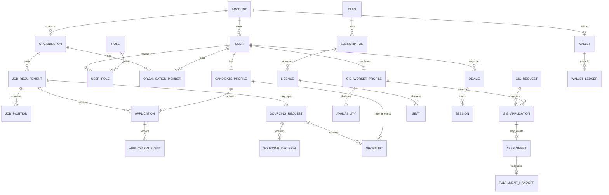

# Talentra Database Design

## Discover and Model dossier

**Status:** Baseline v1.0  
**Prepared:** 2026-10-22  
**Scope:** Talencia Global Data-Driven Development Lifecycle, Phases 1 and 2  
**Source:** `Talentra-Database-Design-Hackathon-Docket (1).pdf` and `Talencia Global - Data-Driven Development Lifecycle - Detailed Playbook.pdf`

This dossier is the Phase 1 and Phase 2 hand-off. It is deliberately a data-design
document, not an application or UI specification. Items marked **Decision** are
proposed choices where the hackathon docket asks the team to decide.

## 0. Executive decisions

| Decision | Choice | Reason |
|---|---|---|
| Database engine | PostgreSQL 16+ | Native UUIDs, range/exclusion constraints, JSONB for controlled integration payloads, partitioning, and row-level security support the stated rules. |
| Tenant boundary | `account` is the tenant; organisations belong to an account | Employers, recruiters, subscriptions, wallets and seats need one enforceable ownership boundary. |
| Gig design | Separate gig domain with shared `user`, `account`, reference data and audit entities | Gig windows, availability, rates, external fulfilment and ratings have materially different integrity rules. Reporting uses conformed dimensions rather than forcing gig rows into the permanent-job lifecycle. |
| Identity model | One `user` identity may have many role assignments and profiles | Avoids duplicate identity records while preserving candidate, recruiter, consultant and TPO capabilities. |
| History | Append-only event/history tables plus current-state columns | Current-state queries remain fast; status transitions, downloads, views, payments and audits remain reconstructable. |
| Deletion | Soft delete for business records; hard delete/anonymise personal data after approved erasure workflow | Preserves financial/audit integrity while supporting privacy rights. |

## 1. Phase 1 — Discover

### 1.1 Problem, goals and scope

**Problem statement:** legacy job and candidate systems contain inconsistent
records, candidate retention is low, and hiring stakeholders lack one trusted
pipeline view. Talentra must provide a secure, auditable operational database
and an analytical foundation for candidates, employers, recruiters, consultants,
placement officers and administrators.

**Goals**

1. Create one identity and account boundary for all actors.
2. Make candidate profiles searchable without allowing blocked or unauthorised
   parties to see personal data.
3. Track job requirements and applications from posting through outcome.
4. Support consultant sourcing, gig work, wallet/credit usage and subscriptions.
5. Produce an auditable pipeline and analytics-ready history.
6. Operate at the docket scale: 1,000,000 candidate profiles, 100,000 job
   requirements and 5,000,000 applications on a laptop; extrapolate to
   10,000,000 / 1,000,000 / 100,000,000 respectively.

**In scope:** logical and physical data model, synthetic seed data, performance
validation, security design, analytics layer, licence/device management,
payments/subscriptions, multilingual data and panel defence.

**Out of scope:** UI, live external-service integration, loading the full
10-million-profile target on a laptop, and ETL/data migration implementation.
Integration contracts and migration ownership are documented as boundaries only.
Employer sub-roles (posting/interviewing/pipeline) are also out of scope for v1;
the account-role model is intentionally extensible for them later.

### 1.2 Requirements docket

Priority: **M** = mandatory, **S** = should-have, **D** = differentiator/optional.

| ID | Requirement | Priority | Actor(s) | Source / ambiguity |
|---|---|---:|---|---|
| REQ-001 | Register users, authenticate them, manage roles, consent and sessions. | M | All, Admin | Docket §3–4; credential provider is not selected. |
| REQ-002 | Maintain candidate contact, education, experience, skills and languages. | M | Candidate | Docket §4. |
| REQ-003 | Create resume versions, projects, assessments and profile-completion data. | S | Candidate | Docket Tier 2; resume file storage boundary needs final deployment choice. |
| REQ-004 | Register and verify employer/client organisations, locations, tax and registration references. | M | Employer, Account Admin, Admin | Docket §4; raw tax/identity values must not be stored in clear text. |
| REQ-005 | Post, publish, search and manage job requirements and positions. | M | Employer, Recruiter, TPO | Docket §2, §4. |
| REQ-006 | Attach questionnaires and capture candidate answers. | M | Employer, Candidate | Core workflow; question versioning is required. |
| REQ-007 | Apply to jobs and track applied, shortlisted, interviewed, offered, joined and rejected states. | M | Candidate, Employer, Recruiter, TPO | Docket §2–4; transition guards are defined below. |
| REQ-008 | Restrict recruiters to their own company’s assigned requirements. | M | Recruiter | Docket §3; database RLS plus access-layer checks. |
| REQ-009 | Source candidates, run bulk outreach and maintain consultant shortlists. | M | Employer, Recruiter, Consultant | Docket §2, §4. |
| REQ-010 | Allow consultant requests to be accepted or declined by an employer. | M | Consultant, Employer | Docket §2. |
| REQ-011 | Let candidates block employers, recruiters or consultants; blocked parties cannot view the candidate. | M | Candidate | Docket §3; enforced in every profile-view/search path. |
| REQ-012 | Prevent recruiters from registering candidates; allow contact only. | M | Recruiter | Docket §3; no candidate-create permission for recruiter role. |
| REQ-013 | Maintain wallets, recharges, credit consumption and immutable ledger entries. | M | Employer, Admin | Docket §2, §4. |
| REQ-014 | Manage plans, subscriptions, licences, seats, devices, sessions, renewals and cancellations. | M | Account Admin, Admin | Docket §4. |
| REQ-015 | Enforce maximum devices and active sessions per licensed user, including concurrent attempts. | M | User, Admin | Docket rule group 9. |
| REQ-016 | Manage gigs with windows, fixed/rate pricing, worker availability, applications, ratings and external fulfilment handoff. | M | Gig worker, Requester, Admin | Docket §2, §4; fulfilment remains external. |
| REQ-017 | Store external earnings references and reconciled amounts without owning fulfilment. | M | Gig fulfilment system | Docket integration boundary. |
| REQ-018 | Send notifications and job alerts using language/privacy preferences and retain delivery status. | M | All, Notification provider | Docket §2, §4; message-body retention is limited. |
| REQ-019 | Provide support tickets and FAQs. | S | All, Support | Docket Tier 2. |
| REQ-020 | Record sensitive actions, errors, views, downloads, activity, referrals and shortlist/bookmark history. | M/S | All, Auditor | Docket §4; mandatory for sensitive actions. |
| REQ-021 | Support UTF-8 user content and translated UI labels with a fallback language. | M | All | Docket rule group 7. |
| REQ-022 | Supply conformed operational history and analytics facts for pipeline, sourcing, gig, revenue and retention KPIs. | M | Admin, Analysts | Docket scope and analytics module. |
| REQ-023 | Provide optional community, reactions, courses, salary benchmarks, company ratings, trends, aggregates and feature flags. | D | All | Docket Tier 2/3; excluded from baseline physical tables except extension points. |

**Open questions to resolve before Phase 3:** payment provider, identity
provider, object storage for resumes, supported UI languages, exact credit
price list, retention periods approved by legal, and whether TPO is scoped to an
account or institution. The model uses provider-neutral references and does not
block those decisions.

### 1.3 Personas and role-permission matrix

| Persona | Primary goals | Allowed capabilities | Explicit denial |
|---|---|---|---|
| Guest | Discover public jobs and register | Read published public job summaries; create own registration | No candidate/contact detail, application or admin data |
| Candidate | Build profile, search, apply, control visibility | Own profile/resume/application, blocks, alerts, consent, gig-worker profile | Cannot administer other users or see another candidate’s private data |
| Employer | Hire and manage organisation demand | Own organisation, jobs, applications, sourcing, wallet, gig requests | Cannot access another account; blocked candidates are filtered |
| Recruiter | Source for assigned employer/company | Assigned requirements, contact/outreach, candidate search subject to consent/blocks | Cannot register a candidate; cannot see unassigned-company requirements |
| Consultant | Work accepted sourcing requests | Open consultant requests, candidate shortlist and recommendation | Cannot work a closed/unassigned request |
| Placement Officer (TPO) | Coordinate campus/fresher hiring | Institution-scoped jobs, candidates and pipeline | No unrelated account data |
| Account Admin | Operate one tenant | Users/roles/seats/subscription/settings for own account | No platform-wide admin or raw credentials |
| Admin | Operate platform | Verification, support, moderation, audit review, controlled impersonation | No silent audit bypass |
| Super Admin | Governance | Platform configuration and break-glass operations | Every break-glass action is audited |
| Scheduled jobs | Expiry, retention, notifications, reconciliation | Only service identities and scoped jobs | No interactive user privilege |
| Auditor/support | Investigate | Read the minimum assigned audit/support scope | No mutation of business or audit history |

Enforcement is layered: PostgreSQL row-level security for tenant and block
boundaries, database constraints/triggers for invariants, and application
authorization for workflow permission checks. The UI is never the sole control.

### 1.4 Feature and competitor discovery

The matrix is a capability benchmark, not a claim of internal competitor schema.
“Known” means the public product category is known to expose the capability.

| Capability / data element | Talentra | Naukri | Monster | LinkedIn | Talentra decision |
|---|---:|---:|---:|---:|---|
| Candidate identity/contact and privacy | Yes | Yes | Yes | Yes | M; consent and field-level classification |
| Education, experience, skills, languages | Yes | Yes | Yes | Yes | M; normalized references plus entered text |
| Resume versions/projects/assessments | Yes | Yes | Partial | Partial | S; versioned, auditable |
| Job search, saved alerts and applications | Yes | Yes | Yes | Yes | M; event history |
| Employer pages, verification and locations | Yes | Yes | Yes | Yes | M; verification boundary |
| Recruiter/company assignment boundary | Yes | Partial | Partial | Partial | Differentiator; explicit RLS |
| Pipeline states, interviews and offers | Yes | Partial | Partial | Partial | M; state machine |
| Consultant sourcing marketplace | Yes | Partial | Partial | Partial | M; request/decision/shortlist |
| Gig windows, availability and external earnings | Yes | No/partial | No/partial | No/partial | Differentiator; separate domain |
| Wallet, credits, subscriptions and seats | Yes | Partial | Partial | Partial | M; append-only money history |
| Device/session limits and audit | Yes | Partial | Partial | Partial | M; concurrent enforcement |
| Candidate block lists and profile visibility | Yes | Partial | Partial | Partial | M; deny by default on block |
| Community posts/reactions/courses | Stretch | Partial | Partial | Yes | Tier 2/3, not a Phase 2 blocker |

### 1.5 NFR register

These are measurable design targets for the hackathon. They must be validated in
Phase 3 against generated data; they are not presented as measured results.

| ID | Target | Measurement method |
|---|---|---|
| NFR-001 | At laptop scale, published-job search p95 <= 500 ms for 100,000 jobs. | 30 warm and 30 cold representative queries; record `EXPLAIN (ANALYZE, BUFFERS)`. |
| NFR-002 | Application status read/write p95 <= 300 ms / 500 ms at 5,000,000 applications. | Parameterized workload with indexed candidate/job keys. |
| NFR-003 | Tenant and block predicates add <= 20% to profile-search p95. | Same query with and without policy predicates. |
| NFR-004 | Database availability target 99.9% monthly; RPO <= 15 minutes; RTO <= 60 minutes. | Backup restore and failover exercise. |
| NFR-005 | No plaintext credentials, national IDs, tax IDs, card numbers or bank data at rest. | Schema scan, fixture inspection and security review. |
| NFR-006 | 100% of sensitive actions have an append-only audit record with actor/time/outcome. | Generate an action catalogue and reconciliation query. |
| NFR-007 | Active sessions never exceed licensed device count, including concurrent login races. | Parallel transaction test at the limit and one above it. |
| NFR-008 | 100% of mandatory workflows map to at least one entity and one persisted event/history record. | Workflow-to-entity coverage matrix. |
| NFR-009 | All stored timestamps are UTC; source timezone is retained where display semantics require it. | Dictionary/type checks and fixture scan. |
| NFR-010 | Full-scale extrapolation covers 10M profiles, 1M requirements and 100M applications from measured laptop results. | Index/plan/cache growth model; identify first degrading query. |
| NFR-011 | UTF-8 content and translated labels support at least English plus one configured locale. | Round-trip multilingual fixture test. |
| NFR-012 | Personal data has an access policy, masking rule and retention/erasure action. | Classification register completeness query. |

### 1.6 Core workflows and exceptions

| ID | Trigger and outcome | Main steps / decisions | Exceptions to persist |
|---|---|---|---|
| WF-001 Registration/login | Guest registers; authenticated session is created | Create user -> verify consent -> credential event -> device/session check -> audit | Duplicate identifier, failed verification, device limit, revoked device |
| WF-002 Candidate profile | Candidate saves a searchable profile/resume | Upsert contact -> education/experience/skills -> resume version -> completion score -> activity event | Invalid reference, missing consent, erasure request |
| WF-003 Job lifecycle | Employer publishes a requirement | Verify organisation -> create requirement/positions -> optionally questionnaire -> charge credits -> publish | Unverified org, insufficient credits, invalid dates, close/expire |
| WF-004 Search and apply | Candidate applies once to an eligible position | Search policy filter -> create application -> questionnaire answers -> status events | Closed job, duplicate application, blocked employer, withdrawn application |
| WF-005 Hiring pipeline | Employer advances/rejects application | Validate transition -> create status history -> optional interview/offer/join | Illegal transition, concurrent update, candidate withdrawal |
| WF-006 Sourcing/outreach | Employer/recruiter contacts candidates | Create batch -> authorize company assignment -> reserve credits -> recipients -> delivery outcomes | Block/consent exclusion, provider retry, partial batch |
| WF-007 Consultant request | Employer asks consultant to source | Create open request -> consultant accepts/declines -> shortlist candidates -> employer decision | Closed request, consultant not authorized, duplicate recommendation |
| WF-008 Gig fulfilment | Requester accepts a gig application | Validate non-overlap -> assignment -> external handoff -> reconcile status/earnings -> rating | Provider down, duplicate webhook, rejected handoff, disputed earnings |
| WF-009 Wallet/subscription | Account purchases or consumes credits | Payment order -> provider status -> invoice/refund or wallet ledger -> credit consumption | Timeout, duplicate callback, refund correction, negative balance |
| WF-010 Support/notification | Event needs notification or support response | Resolve preferences -> create notification delivery; ticket status updates | Provider failure/retry, suppressed notification, SLA breach |

### 1.7 Discover exit checklist (G1)

- Every requirement has an ID and actor(s): **yes**, REQ-001–023.
- Every NFR has a numeric target and test method: **yes**, NFR-001–012.
- Every mandatory feature appears in a workflow: **yes**, WF-001–010.
- Ambiguities are explicit: provider choices, languages, retention and TPO scope.

## 2. Phase 2 — Model

### 2.1 Naming and physical conventions

PostgreSQL schemas are `ref`, `iam`, `account`, `profile`, `jobs`, `sourcing`,
`gig`, `billing`, `comms`, `support`, and `audit`. Tables are singular
`snake_case`; primary keys are `uuid`; foreign keys use `<entity>_id`.
Transactional tables use `created_at`, `created_by`, `updated_at`, `updated_by`;
soft-deletable rows additionally use `deleted_at`. UTC timestamps are
`timestamptz`. Analytics objects are prefixed `an_` and use `dim_`, `fact_` and
`agg_` names. Large append-only tables (`application_event`, `audit_event`,
`notification_delivery`, ledger tables) are monthly range-partitioned by UTC
event time.

### 2.2 Entity catalogue

| ID | Entity / physical table | Definition | Owner |
|---|---|---|---|
| ENT-001 | `account.account` | Tenant boundary and account status | Account |
| ENT-002 | `iam.user` | Human/service identity | Administration |
| ENT-003 | `iam.credential` | Password/identity-provider credential metadata | Administration |
| ENT-004 | `iam.role`, `iam.permission`, `iam.user_role`, `iam.role_permission` | Authorization vocabulary and assignments | Administration |
| ENT-005 | `iam.consent` | Versioned consent decision | Administration |
| ENT-006 | `iam.device`, `iam.session`, `iam.login_attempt` | Device registration and login state/history | Licences |
| ENT-007 | `account.organisation`, `account.organisation_member` | Employer/client/recruiter organisation and membership | Organisation |
| ENT-008 | `account.organisation_location`, `account.verification` | Organisation sites and external verification outcome | Organisation |
| ENT-009 | `profile.candidate_profile` | Candidate-owned personal/profile visibility data | Profile |
| ENT-010 | `profile.education`, `profile.work_experience` | Candidate education and employment history | Profile |
| ENT-011 | `profile.candidate_skill`, `profile.candidate_language` | Candidate many-to-many capabilities | Profile |
| ENT-012 | `profile.resume`, `profile.resume_version`, `profile.project` | Versioned resumes and portfolio projects | Profile |
| ENT-013 | `profile.assessment`, `profile.assessment_result`, `profile.completion_score` | Self-assessments and completion metrics | Profile |
| ENT-014 | `profile.profile_view`, `profile.profile_download`, `profile.bookmark` | Append-only access/history records | Profile/Billing |
| ENT-015 | `profile.block` | Candidate-to-party or party-to-user visibility block | Administration |
| ENT-016 | `jobs.job_requirement` | Demand/recruitment requirement and lifecycle | Jobs |
| ENT-017 | `jobs.job_position` | A countable position within a requirement | Jobs |
| ENT-018 | `jobs.questionnaire`, `jobs.question`, `jobs.answer` | Versioned screening questions and answers | Jobs |
| ENT-019 | `jobs.application`, `jobs.application_event` | Candidate application current state and history | Jobs |
| ENT-020 | `jobs.interview`, `jobs.offer`, `jobs.join` | Pipeline outcome records | Jobs |
| ENT-021 | `sourcing.sourcing_request`, `sourcing.decision` | Consultant sourcing request and decision | Sourcing |
| ENT-022 | `sourcing.outreach_batch`, `sourcing.outreach_recipient`, `sourcing.shortlist` | Bulk outreach and recommendations | Sourcing |
| ENT-023 | `gig.worker_profile`, `gig.availability`, `gig.service` | Gig-specific worker capabilities and windows | Gig |
| ENT-024 | `gig.gig_request`, `gig.gig_application`, `gig.assignment` | Gig demand, application and accepted work | Gig |
| ENT-025 | `gig.fulfilment_handoff`, `gig.earning_reconciliation`, `gig.rating`, `gig.worker_list` | External boundary, earnings, ratings and favourites/blacklists | Gig |
| ENT-026 | `billing.plan`, `billing.subscription`, `billing.licence`, `billing.seat` | Commercial plans, periods and allocations | Billing |
| ENT-027 | `billing.payment_order`, `billing.invoice`, `billing.refund` | Provider references and payment history | Billing |
| ENT-028 | `billing.wallet`, `billing.wallet_ledger`, `billing.credit_consumption` | Append-only credits and balance projection | Billing |
| ENT-029 | `comms.notification_preference`, `comms.job_alert`, `comms.notification_delivery` | Preferences, alerts and provider delivery outcomes | Notifications |
| ENT-030 | `comms.translation_key`, `comms.translation` | Localized UI labels | Master data |
| ENT-031 | `support.ticket`, `support.faq` | Support workflow and searchable help | Support |
| ENT-032 | `audit.audit_event`, `audit.error_event` | Append-only sensitive-action and error logs | Administration |
| ENT-033 | `ref.country`, `ref.state`, `ref.city`, `ref.skill`, `ref.qualification`, `ref.industry`, `ref.job_role`, `ref.code` | Controlled master/enumeration data | Team |
| ENT-034 | `an_dim_account`, `an_dim_date`, `an_dim_job`, `an_dim_candidate`, `an_fact_application`, `an_fact_gig`, `an_fact_payment` | Conformed analytical dimensions and facts | Analytics |

### 2.3 Logical relationship model

Cardinality is stated in both directions by the notation: `||` is exactly one,
`o|` zero-or-one, `|{` one-or-many and `o{` zero-or-many. A job has one owning
organisation and one or more positions; a position may have many applications,
while each application belongs to exactly one candidate and position.

### 2.4 Attribute dictionary v1

The following is the v1 queryable dictionary. All tables inherit the standard
audit columns unless noted. `PK`, `FK`, `NN`, `UQ` mean primary key, foreign
key, not-null and unique. Personal classification is `Public`, `Internal`,
`Personal` or `Sensitive`.

| Table | Columns (type; constraints; classification; meaning/example) |
|---|---|
| `account.account` | `account_id uuid PK`; `name varchar(200) NN`; `status ref.code NN`; `default_language_code varchar(10) NN`; tenant name/status/language (`Acme Staffing`, `active`, `en`) — Internal |
| `iam.user` | `user_id uuid PK`; `account_id uuid FK NN`; `email_normalized citext UQ`; `display_name varchar(200)`; `status ref.code NN`; `last_login_at timestamptz`; identity and lifecycle — email/display name Personal, status Internal |
| `iam.credential` | `credential_id uuid PK`; `user_id uuid FK NN`; `provider ref.code NN`; `subject_token bytea NN`; `password_hash bytea`; `verified_at timestamptz`; provider token/hash only — Sensitive |
| `iam.user_role` | `user_id uuid FK`; `role_id uuid FK`; `account_id uuid FK`; `valid_from date NN`; `valid_to date`; PK `(user_id, role_id, valid_from)`; effective role assignment — Internal |
| `iam.consent` | `consent_id uuid PK`; `user_id uuid FK NN`; `purpose_code ref.code NN`; `policy_version varchar(30) NN`; `decision boolean NN`; `decided_at timestamptz NN`; legal consent evidence — Personal |
| `iam.device` | `device_id uuid PK`; `user_id uuid FK NN`; `device_fingerprint bytea NN`; `label varchar(100)`; `revoked_at timestamptz`; registered device — Sensitive |
| `iam.session` | `session_id uuid PK`; `user_id uuid FK NN`; `device_id uuid FK NN`; `started_at timestamptz NN`; `last_activity_at timestamptz NN`; `ended_at timestamptz`; `end_reason ref.code`; active login — Sensitive |
| `account.organisation` | `organisation_id uuid PK`; `account_id uuid FK NN`; `legal_name varchar(250) NN`; `organisation_type ref.code NN`; `status ref.code NN`; `website text`; employer/client — Internal |
| `account.verification` | `verification_id uuid PK`; `organisation_id uuid FK NN`; `provider ref.code NN`; `lookup_reference bytea NN`; `outcome ref.code NN`; `verified_at timestamptz`; external verification token/reference — Sensitive |
| `profile.candidate_profile` | `candidate_id uuid PK/FK user`; `headline varchar(240)`; `summary text`; `visibility ref.code NN`; `years_experience numeric(5,2)`; `consent_to_contact boolean NN`; personal profile — Personal |
| `profile.education` | `education_id uuid PK`; `candidate_id uuid FK NN`; `qualification_id uuid FK`; `institution varchar(250)`; `start_date date`; `end_date date`; education record — Personal |
| `profile.work_experience` | `experience_id uuid PK`; `candidate_id uuid FK NN`; `employer_name varchar(250)`; `job_role_id uuid FK`; `start_date date NN`; `end_date date`; `description text`; experience — Personal |
| `profile.candidate_skill` | `candidate_id uuid FK`; `skill_id uuid FK`; `proficiency ref.code`; `years numeric(5,2)`; PK `(candidate_id, skill_id)`; normalized skill — Personal |
| `profile.resume_version` | `resume_version_id uuid PK`; `candidate_id uuid FK NN`; `version_no integer NN`; `language_code varchar(10) NN`; `content_uri text`; `is_current boolean NN`; immutable version pointer — Personal |
| `profile.project` | `project_id uuid PK`; `candidate_id uuid FK NN`; `name varchar(200) NN`; `role varchar(150)`; `start_date date`; `end_date date`; `outcome text`; portfolio project — Personal |
| `jobs.job_requirement` | `requirement_id uuid PK`; `organisation_id uuid FK NN`; `owner_user_id uuid FK NN`; `job_role_id uuid FK NN`; `employment_type ref.code NN`; `work_type ref.code NN`; `status ref.code NN`; `published_at timestamptz`; `consultant_open boolean NN`; demand lifecycle — Internal/Public after publication |
| `jobs.job_position` | `position_id uuid PK`; `requirement_id uuid FK NN`; `position_count integer NN`; `location_id uuid FK`; `salary_min numeric(14,2)`; `salary_max numeric(14,2)`; `currency char(3)`; count and range — Internal |
| `jobs.question` | `question_id uuid PK`; `questionnaire_id uuid FK NN`; `prompt text NN`; `question_type ref.code NN`; `required boolean NN`; `sort_order integer NN`; screening question — Internal/Public when published |
| `jobs.application` | `application_id uuid PK`; `position_id uuid FK NN`; `candidate_id uuid FK NN`; `status ref.code NN`; `applied_at timestamptz NN`; `source ref.code NN`; UQ `(position_id,candidate_id)`; pipeline current state — Personal/Internal |
| `jobs.application_event` | `application_event_id uuid PK`; `application_id uuid FK NN`; `from_status ref.code`; `to_status ref.code NN`; `actor_user_id uuid FK NN`; `occurred_at timestamptz NN`; transition reason — Personal/Internal |
| `sourcing.sourcing_request` | `sourcing_request_id uuid PK`; `requirement_id uuid FK NN`; `consultant_user_id uuid FK`; `status ref.code NN`; `opened_at timestamptz NN`; `decided_at timestamptz`; consultant request — Internal |
| `sourcing.outreach_recipient` | `recipient_id uuid PK`; `batch_id uuid FK NN`; `candidate_id uuid FK NN`; `credit_consumption_id uuid FK`; `delivery_status ref.code NN`; `delivered_at timestamptz`; outreach evidence — Personal |
| `gig.worker_profile` | `worker_profile_id uuid PK`; `user_id uuid FK UQ`; `bio text`; `default_currency char(3) NN`; `min_rate numeric(14,2)`; `max_rate numeric(14,2)`; separate gig profile — Personal |
| `gig.availability` | `availability_id uuid PK`; `worker_profile_id uuid FK NN`; `window tstzrange NN`; `status ref.code NN`; `source ref.code NN`; worker availability — Personal |
| `gig.gig_request` | `gig_request_id uuid PK`; `account_id uuid FK NN`; `requester_user_id uuid FK NN`; `title varchar(200) NN`; `window tstzrange NN`; `pricing_type ref.code NN`; `price numeric(14,2) NN`; `status ref.code NN`; project request — Internal/Public when published |
| `gig.gig_application` | `gig_application_id uuid PK`; `gig_request_id uuid FK NN`; `worker_profile_id uuid FK NN`; `status ref.code NN`; `applied_at timestamptz NN`; UQ `(gig_request_id,worker_profile_id)`; one-direction application — Internal |
| `gig.assignment` | `assignment_id uuid PK`; `gig_application_id uuid FK UQ`; `status ref.code NN`; `accepted_at timestamptz`; `external_handoff_reference varchar(200)`; accepted work — Internal |
| `billing.plan` | `plan_id uuid PK`; `code varchar(50) UQ`; `name varchar(150) NN`; `max_users integer NN`; `max_devices_per_user integer NN`; `credit_entitlement numeric(14,2)`; commercial entitlement — Public/Internal |
| `billing.subscription` | `subscription_id uuid PK`; `account_id uuid FK NN`; `plan_id uuid FK NN`; `period tstzrange NN`; `status ref.code NN`; `renewal_at timestamptz`; non-overlapping period — Internal |
| `billing.wallet_ledger` | `ledger_entry_id uuid PK`; `wallet_id uuid FK NN`; `entry_type ref.code NN`; `amount numeric(14,2) NN`; `currency char(3) NN`; `reference_type varchar(60)`; `reference_id uuid`; `reverses_entry_id uuid`; immutable credit/money event — Sensitive |
| `billing.payment_order` | `payment_order_id uuid PK`; `account_id uuid FK NN`; `provider ref.code NN`; `provider_reference varchar(200) UQ`; `amount numeric(14,2) NN`; `status ref.code NN`; `paid_at timestamptz`; no card/bank data — Sensitive |
| `comms.notification_delivery` | `delivery_id uuid PK`; `user_id uuid FK NN`; `channel ref.code NN`; `template_key varchar(150) NN`; `provider_reference varchar(200)`; `status ref.code NN`; `attempted_at timestamptz`; body is not retained beyond policy — Personal |
| `audit.audit_event` | `audit_event_id uuid PK`; `actor_user_id uuid`; `account_id uuid`; `action_code ref.code NN`; `entity_type varchar(100) NN`; `entity_id uuid`; `occurred_at timestamptz NN`; `outcome ref.code NN`; `metadata jsonb`; append-only evidence — Sensitive |

Nullable columns above are justified where the value is not known at creation
or is genuinely not applicable (for example `ended_at` for an active session,
`published_at` for a draft, and `salary_max` when undisclosed). Unknown and
not-applicable are represented by separate status/domain values; empty strings
and sentinel zeroes are prohibited.

### 2.5 Lifecycle and state machines

| Entity | States and valid transitions | Guard / actor |
|---|---|---|
| User | `pending -> active -> suspended -> active`; `active -> deleted` (final) | Verification/admin; erasure workflow for delete |
| Job requirement | `draft -> pending_review -> published -> paused -> published`; `published -> closed`; `published -> expired` | Owner/admin; credits and required fields before publish |
| Application | `applied -> shortlisted -> interviewed -> offered -> joined`; any non-final state -> `rejected` or `withdrawn` | Candidate/authorised employer; transition trigger validates current state |
| Sourcing request | `open -> accepted -> fulfilled`; `open -> declined`; `open -> cancelled`; `accepted -> cancelled` | Consultant decision; requirement must be `consultant_open` |
| Gig request | `draft -> published -> paused -> published`; `published -> closed/expired` | Requester/admin; valid window and price |
| Gig application | `submitted -> accepted/rejected/withdrawn` | Requester accepts/rejects; accepted creates one assignment |
| Assignment | `pending_handoff -> handed_off -> in_progress -> completed`; `pending_handoff -> failed`; `in_progress -> cancelled` | External reconciliation; no internal fulfilment |
| Payment order | `created -> pending -> paid`; `pending -> failed/expired`; `paid -> refunded` | Provider callback; idempotency key required |
| Subscription | `scheduled -> active -> past_due -> cancelled/expired`; `active -> renewed` | Payment/reconciliation job; no overlapping periods |
| Session | `started -> active -> ended/revoked/expired` | Login/logout/security job; only active sessions count |

Illegal transitions are rejected and audited, including `joined -> interviewed`,
`rejected -> offered`, `accepted gig application -> submitted`, `paid ->
pending`, and `ended session -> active`.

### 2.6 Data rules and enforcement catalogue

| ID | Rule | Enforcement |
|---|---|---|
| BR-001 | All PKs are UUIDs; all FKs reference existing non-deleted parents. | Database PK/FK and soft-delete trigger |
| BR-002 | A candidate may apply only once per position. | Database unique `(position_id,candidate_id)` |
| BR-003 | Application transitions must be in the state table. | Transactional function + `application_event` trigger |
| BR-004 | Recruiter can read/act only on requirements assigned to their organisation. | PostgreSQL RLS using effective `organisation_member` mapping |
| BR-005 | Consultant can act only when `job_requirement.consultant_open = true` and request is open. | Database function/trigger and application authorization |
| BR-006 | A blocked party cannot view/search/download the candidate. | Shared security predicate/RLS on profile access tables |
| BR-007 | Recruiters cannot create candidate identities/profiles. | Permission matrix and database grant; outreach only |
| BR-008 | Every sensitive action creates an immutable audit event. | Audit trigger/function; audit role cannot update/delete |
| BR-009 | Gig worker availability and assignments cannot overlap. | PostgreSQL `EXCLUDE USING gist` on `tstzrange` per worker |
| BR-010 | Gig request end is not before start; price is non-negative and currency is valid. | Range and check constraints |
| BR-011 | Active sessions per user do not exceed licence device limit. | Serializable transaction locks seat/licence row; failed attempt audited |
| BR-012 | Subscription periods for one licence cannot overlap. | PostgreSQL exclusion constraint on `tstzrange` |
| BR-013 | Wallet/payment ledgers are append-only; corrections reference the original. | Restricted grants + trigger requiring reversal reference |
| BR-014 | A wallet cannot consume more available credits than its balance. | Serialized ledger function; no direct balance update |
| BR-015 | Money uses `numeric(14,2)` and ISO-4217 currency; no floating point. | Domain/check constraints |
| BR-016 | Enumerations are lookup rows with code, translated label, active flag and sort order. | FK to `ref.code`; no free-text status columns |
| BR-017 | All business rows carry creator/updater and timestamps; soft-deleted rows are excluded by default. | Standard columns, trigger and views/RLS |
| BR-018 | UI keys are translated by language with default-language fallback; user content records entry language. | FKs/unique key and application query helper |
| BR-019 | External callbacks are idempotent by provider plus event/reference key. | Unique idempotency key and inbox transaction |
| BR-020 | Unknown is not zero/empty/`NA`; nullable fields require a reason. | Check constraints, domains and dictionary review |

### 2.7 Data classification, privacy and retention

| Class | Examples | Access/masking | Baseline retention |
|---|---|---|---|
| Public | Published job title, public organisation name, translated UI label | Public read after publication | Until unpublishing plus 30 days cache |
| Internal | Draft jobs, account membership, pipeline aggregate, plan limits | Tenant members with permission | Account life + 7 years for commercial records |
| Personal | Candidate name/contact, resume, education, profile views | Need-to-know, block/consent predicate, masked exports | Active account + 24 months inactivity; erase/anonymise on approved request |
| Sensitive | Credential hashes/tokens, tax/identity references, payment references, audit metadata | Encryption/tokenisation, masked logs, restricted roles | Credentials until rotation/deletion; financial/audit records 7 years unless law requires longer |

Controls:

- Encrypt sensitive columns with application-managed envelope keys; never store
  raw passwords, card numbers, bank details or national identity numbers.
- Candidate exports mask email/phone by default. Profile downloads/views require
  permission, consent policy and an audit record.
- Erasure jobs remove or anonymise personal profile fields while retaining
  referentially safe aggregate, financial and audit evidence. A deletion request
  itself is an auditable event.
- Test and seed data uses synthetic identities only.
- RLS policies require both tenant membership and absence of an applicable
  `profile.block` row. Admin break-glass access requires a reason and audit row.

### 2.8 Integration boundary decisions

| Boundary | Source of truth | Store vs reference | Failure/idempotency/audit |
|---|---|---|---|
| Payment gateway | Gateway for payment status; Talentra for order/invoice/ledger | Store provider reference, amount, status and timestamps; never card/bank data | Keep order `pending`, retry with exponential backoff; unique provider event key; audit callback |
| Identity verification | Verification provider | Store outcome, token and checked-at; not raw identity number | Mark pending on outage; provider request idempotency key; audit request/outcome |
| Company/tax verification | External registry | Store lookup reference, outcome and checked-at | Organisation remains unverified on outage; unique lookup/event; audit |
| Gig fulfilment | Fulfilment system | Store handoff reference, assignment status and reconciled earnings | Assignment remains pending/retryable; webhook inbox is idempotent; audit reconciliation |
| Legacy systems | Field-level migration/sync contract | Store external source ID and last-sync metadata; Talentra is target of record after cutover | Retry/quarantine conflicts; unique `(source_system,source_id)`; audit sync result |
| Messaging providers | Provider for delivery; Talentra for preference/status | Store template key, provider ref, status and minimal body hash | Retry failed delivery and dead-letter after limit; unique message key; audit delivery |
| Mapping/geolocation | Mapping provider | Optional place reference/coordinates with source and precision | Keep user-entered location if down; unique request key; audit enrichment |
| Reviews/salary reference | Source provider | Store attributed snapshot and refresh date | Keep last known snapshot; unique source/version; audit refresh |

### 2.9 Phase 2 exit checklist (G2)

- Entity catalogue covers every workflow and hidden history/audit/reference
  entity: **yes**.
- Every dictionary entry has a type, constraint, meaning, example/domain and
  classification: **yes for the v1 baseline tables; extend the same template to
  optional Tier 2/3 tables before implementation**.
- Every lifecycle status has an entry/exit or is final: **yes**.
- Every relationship has cardinality and ownership: **yes**.
- Every rule states database, application or pipeline enforcement: **yes**.
- Every personal/sensitive class has masking/access and retention treatment:
  **yes**.

## 3. Traceability and next phase hand-off

| Discover item | Model evidence |
|---|---|
| REQ-001, 008, 012, 015 | `iam.*`, `account.organisation_member`, BR-004/007/011 |
| REQ-002, 003, 020 | `profile.*`, `jobs.application_event`, `audit.audit_event` |
| REQ-004, 005, 006, 007 | `account.*`, `jobs.*`, lifecycle table |
| REQ-009, 010, 011 | `sourcing.*`, `profile.block`, BR-005/006 |
| REQ-013, 014 | `billing.*`, BR-012–015 |
| REQ-016, 017 | `gig.*`, BR-009/010 and fulfilment boundary |
| REQ-018, 019, 021 | `comms.*`, `support.*`, translation rules |
| REQ-022 | `an_dim_*`, `an_fact_*`, append-only history tables |

**Ready for Phase 3 (Prove):** generate seeded data at the docket’s laptop
scale, include every state and illegal transition, test all BR/NFR items, and
measure the indexed search/application queries before extrapolating to the
full-scale target. Any failed coverage or performance test loops back to the
owning Discover or Model item rather than being hidden in implementation.
 ye rhi dono phases